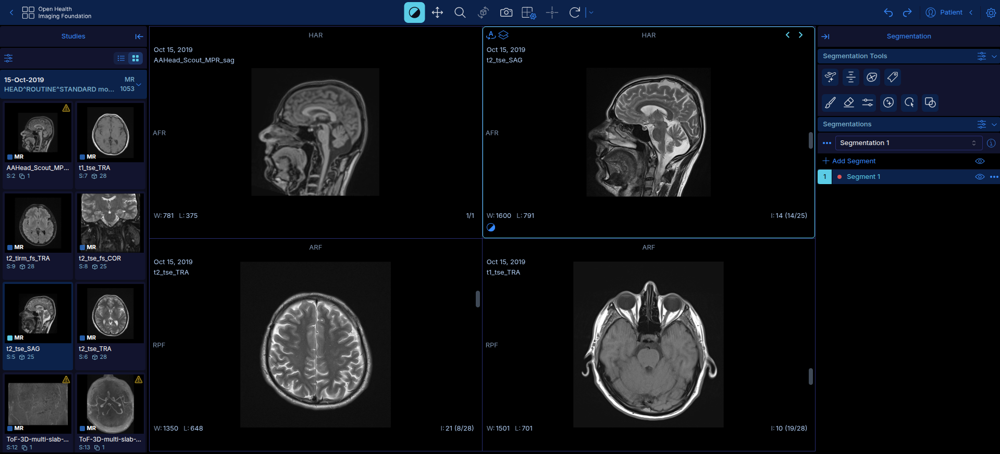
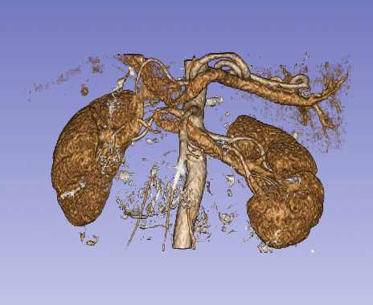
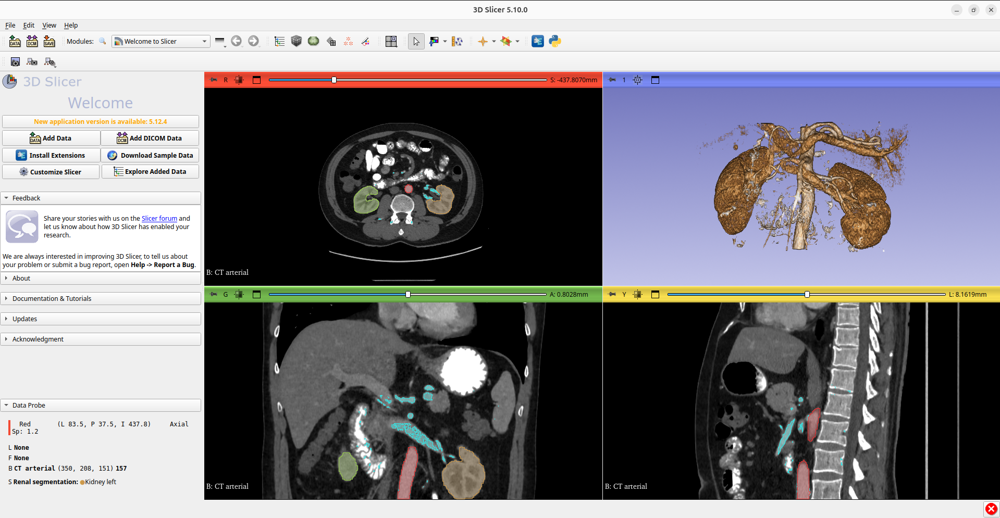

# Examples

What MOONAI Radiology produces, on real but **anonymized** studies (one adult, 2019):
names, dates of birth, file paths and identifiers are removed. Research output only —
not a diagnosis.

Each analysis writes `results/<run>/report.txt` with two parts: the **quantitative
findings computed in code** (volumes, cited reference ranges, flags) and the **draft
report written by the LLM** from those findings only. Reports below were drafted by a
local `qwen3.8-27b` (reasoning off) with the default prompts in
[`config/prompts/`](../config/prompts/); `LLM_REPORT_LANGUAGES=en,sk` also adds a
Slovak translation (omitted here).

---

## 1. Abdominal CT — organ volumetry

`./scripts/inference/run-inference.sh --model wholeBody_ct_segmentation --image datasets/ct/<series>`
(native abdominal CT, 512×512×383, 0.74×0.74×1.25 mm; inference 2 s on GPU).

**Computed in code** (excerpt — 75 structures in total):

```
Model      : wholeBody_ct_segmentation
Modality   : CT   (from DICOM tag)
Sex        : M    (from DICOM tag; used for sex-specific references)

  Structure        Volume (cm³)   Reference (cm³, source)        Flag
  liver               1578.8      824-1700 Kim 2021              ✓
  spleen               298.8      107-314 Prassopoulos 1997      ✓
  kidney_left          184.5      83-192 J-MID p10-p90 M         ✓
  kidney_right         180.4      86-187 J-MID p10-p90 M         ✓
  pancreas              91.5      37-168 Stefanovic 2012         ✓
  small_bowel         1095.3      -
  stomach              400.7      -
  ...
  Spleen craniocaudal length: 10.1 cm  ✓ (≤ 13 cm)
```

The same study through TotalSegmentator gives liver 1595 cm³ and spleen 336 cm³ /
10.9 cm — the engines agree within ~1 % on the liver and ~11 % on the spleen.

**LLM draft report** (English, abridged):

> **CLINICAL INDICATION:** Whole-body CT imaging for volumetric assessment of abdominal
> and thoracic structures.
>
> **TECHNIQUE:** Computed Tomography (CT) scan analyzed using the
> `wholeBody_ct_segmentation` AI model. The study includes 75 segmented structures with a
> voxel size of 0.74×0.74×1.25 mm.
>
> **FINDINGS:**
> - **Liver:** Volume is 1578.8 cm³. This is within the reference range of 824–1700 cm³ (Kim 2021).
> - **Spleen:** Volume is 298.8 cm³. This is within the reference range of 107–314 cm³
>   (Prassopoulos 1997). The craniocaudal length is 10.1 cm, which is within the normal limit (≤ 13 cm).
> - **Kidneys:** Left 184.5 cm³, right 180.4 cm³ — within the reference ranges (J-MID p10-p90 M).
> - **Pancreas:** Volume is 91.5 cm³. This is within the reference range of 37–168 cm³ (Stefanovic 2012).
> - **Stomach** 400.7 cm³, **gallbladder** 21.6 cm³, **urinary bladder** 125.0 cm³, … *(no reference — volume only)*
>
> **IMPRESSION:**
> 1. Volumetric analysis of the liver, spleen, kidneys, and pancreas demonstrates
>    measurements within established reference ranges for a male patient.
> 2. No structures were flagged as abnormal (high, low, or enlarged) by the AI analysis.
> 3. The right upper lobe of the lung shows a very low segmented volume (0.4 cm³), which
>    may represent partial volume effects or segmentation limitation at the apex, but no
>    specific abnormality flag was raised.
>
> **RECOMMENDATION:** No specific recommendation based on the provided volumetric data.

Point 3 is the model's own interpretation (the scan only covers the lung bases) — see
[TODO](TODO.md) P3, stricter IMPRESSION.

---

## 2. Brain MRI — structure volumetry

`./scripts/inference/run-inference.sh --model wholeBrainSeg_Large_UNEST_segmentation --image datasets/mri/<t1-series>`
(3D T1 `t1_fl3d_sag_iso`, 256×248×176, ~1 mm isotropic; 133 classes; 6 s on GPU).

This bundle was trained on T1 images **affinely registered to MNI305**, so the pipeline
registers the scan first (SimpleITK, ~4 s; `scripts/inference/mni_register.py`), runs the
model in template space and converts the volumes back to native mL with the affine's
determinant. Without this step the volumes were about twice too large (total ~2795 cm³).

**Computed in code** (excerpt — 132 structures in total):

```
Model      : wholeBrainSeg_Large_UNEST_segmentation
Modality   : MR   (from DICOM tag)
  Registration: affine to MNI305 (SimpleITK, Mattes MI); the mask is in template space
  and volumes are converted to native mL (× 0.7671, the affine's determinant).

  Structure                       Volume (cm³)   Ref
  left-cerebral-white-matter         281.4        -
  right-cerebral-white-matter        280.0        -
  right-cerebellum-exterior           59.3        -
  left-cerebellum-exterior            49.3        -
  brain-stem                          17.0        -
  left-lateral-ventricle              13.1        -
  right-lateral-ventricle              7.5        -
  right-thalamus-proper                8.5        -
  left-thalamus-proper                 7.9        -
  right-hippocampus                    3.1        -
  left-hippocampus                     2.8        -
  ...
  Total segmented volume: 1347.0 cm³
```

**LLM draft report** (English):

> **CLINICAL INDICATION:** Quantitative volumetric analysis of the brain.
>
> **TECHNIQUE:** AI-assisted segmentation (Model: wholeBrainSeg_Large_UNEST_segmentation)
> of MR imaging. The analysis was performed on a 3D volume (256×248×176 voxels, spacing
> 0.98×0.98×1.00 mm). Segmentation identified 132 structures. Volumes were calculated in
> native space (mL) following affine registration to MNI305 template space.
>
> **FINDINGS:** Quantitative volumetric measurements for 132 brain structures were
> generated. No reference ranges were provided for any of the segmented structures in the
> analysis results; therefore, no values are flagged as abnormal, high, or low.
> Key measured volumes include:
> - **Cerebral White Matter:** Left 280.5 cm³; Right 279.9 cm³.
> - **Cerebellum:** Right exterior 58.8 cm³; Left exterior 49.1 cm³.
> - **Ventricles:** Left lateral 13.0 cm³; Right lateral 7.3 cm³; 4th ventricle 3.5 cm³; 3rd ventricle 2.5 cm³.
> - **Subcortical Structures:** Left thalamus 7.9 cm³; Right thalamus 8.7 cm³; Left
>   hippocampus 2.7 cm³; Right hippocampus 3.1 cm³; Left amygdala 1.1 cm³; Right amygdala 0.8 cm³.
> - **Cerebral Cortex:** Various gyri and lobules were segmented with volumes ranging from
>   0.5 cm³ (accumbens area) to 23.6 cm³ (left middle frontal gyrus).
>
> Total segmented brain volume: 1346.4 cm³.
>
> **IMPRESSION:**
> 1. AI-assisted volumetric segmentation of the brain on MR imaging.
> 2. No structures were flagged as abnormal, as no reference ranges were provided in the analysis data.
> 3. Total segmented brain volume is 1346.4 cm³.
>
> **RECOMMENDATION:** None.

Notes: the code table and the report come from two runs, so values differ by up to
~1 cm³ — the registration samples randomly and is not bit-reproducible yet. This T1 is
**contrast-enhanced**, whereas the model was trained on non-contrast T1. No brain
structure has a reference range yet, so the model correctly reports volumes without
calling them normal or abnormal ([TODO](TODO.md)).

---

## 3. Screenshots

**OHIF Viewer** — brain MRI study from Orthanc in the browser (http://localhost:3000),
four series side by side, segmentation panel on the right:



**3D Slicer — renal arteries** — arterial-phase abdominal CT after
`./scripts/vessels/run-vessel-analysis.sh` (TotalSegmentator bone + bowel removal,
vesselFM vessels) and `./scripts/vessels/open-vessels-in-slicer.sh` (CT-AAA volume
rendering, anterior view): aorta, both kidneys, renal and splenic arteries. Details:
[VESSEL_ANALYSIS](VESSEL_ANALYSIS.md).



The full 3D Slicer window as `open-vessels-in-slicer.sh` sets it up: the arterial CT in
the axial, coronal and sagittal views with the segmentation outlines (aorta red, kidneys
green / orange, vesselFM arteries cyan) and the 3D rendering top right:


